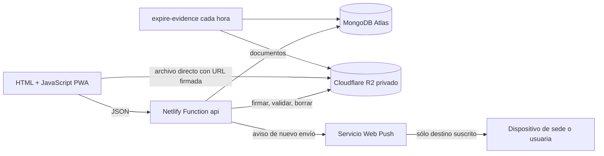

# Mapa del proyecto Rapicostura

Esta es la ruta corta para orientarse en el código. El repositorio Git comienza en `Rapicostura/`; Netlify usa `app/` como base y publica sólo `app/public/`.

```text
Rapicostura/
├─ AGENTS.md                    Reglas breves y enlaces de contexto
├─ cambiosV3.md                 Requisitos de la entrega V3
├─ app/
│  ├─ index.html                Estructura HTML y diálogos de cámara
│  ├─ src/web/
│  │  ├─ app.js                  Estado, vistas, formularios y navegación
│  │  ├─ model.js                Sedes, usuarias, categorías y filtros
│  │  ├─ api.js                  Cliente de API, carga y modo ?demo=1
│  │  ├─ uploads.js              Subida multipart, pausa y reanudación
│  │  ├─ recording.js            Cámara/audio, gestos y portadas
│  │  ├─ pattern.js              Trazo 3×3 y validación geométrica
│  │  ├─ push.js                 Permiso y suscripción Web Push
│  │  ├─ icons.js                Iconos SVG locales
│  │  └─ styles.css              Diseño adaptable y animaciones
│  ├─ server/
│  │  ├─ service.mjs             Rutas y reglas de API
│  │  ├─ domain.mjs              Validaciones y plazos
│  │  ├─ infrastructure.mjs      MongoDB, índices y R2 S3
│  │  ├─ auth.mjs                Patrón, cookie y límites de frecuencia
│  │  ├─ push.mjs                Web Push dirigido al destino
│  │  └─ cleanup.mjs             Borrado de medios y envíos vencidos
│  ├─ netlify/functions/
│  │  ├─ api.mjs                 Entrada HTTP de Functions
│  │  └─ expire-evidence.mjs     Limpieza programada cada hora
│  ├─ scripts/
│  │  ├─ build-app.mjs           Genera public/ y service worker
│  │  └─ dev.mjs                 Servidor local
│  ├─ tests/connected/          Pruebas de API, V3, patrón y cargas
│  ├─ docs/                     Despliegue, decisiones y estilos
│  ├─ .env.example              Sólo nombres de variables
│  └─ public/                   Generado e ignorado por Git
└─ archivo-local/               Respaldo anterior ignorado
```

## Cómo se conectan



**Registrar envío:** `app.js` recoge texto, foto/video y audio; `uploads.js` pide un ticket a `/media/tickets`, envía el archivo directo a R2 y llama a `/media/:id/complete`. `service.mjs` crea el documento `shipments`, liga las referencias de `media` y trata de avisar a las suscripciones de su destino. Un fallo del aviso no revierte el envío.

**Recibir:** la vista Recepción filtra los envíos cuyo `destination` coincide con la entidad seleccionada. `/shipments/:id/receipt` confirma con `confirmedAt`, guarda observación y evidencias y fija el vencimiento 72 horas después. `/media/:id/url` devuelve una URL firmada temporal; `/media/:id/stream` redirige a ella, útil para `audio_url`.

**Tutoriales:** la dueña inicia carga multipart a R2, puede pausar y retomar partes, y publica el documento `videos` con portada. La colección `media` guarda sus claves de R2. No se borran por la regla de 72 horas; sólo al eliminar el tutorial.

**Avisos PWA:** el service worker generado en `build-app.mjs` muestra el aviso y abre `/envios?tab=recepcion&site=…&shipment=…`. El dispositivo se suscribe explícitamente desde «Activar avisos para…». `pushSubscriptions.entity` cambia con el selector. `VAPID_PRIVATE_KEY` sólo vive en Functions. La pantalla Bot WhatsApp no participa en estos flujos.

## Dónde se guarda cada cosa

| Colección/servicio | Contenido |
| --- | --- |
| `shipments` | Origen, destino, estado, fechas, observaciones, referencias y duración de audio. |
| `users` | Usuarias editables con ID estable y estado activo/eliminado. Las cinco sedes están en código. |
| `media` | Estado de carga, tipo, clave privada R2, vínculo y caducidad. |
| `videos` | Tutoriales publicados, categoría, descripción y portada. |
| `pushSubscriptions` | Endpoint y claves públicas del dispositivo asociados a un destino. |
| `settings`, `sessions`, `rateLimits` | Patrón de dueña, sesiones y protección básica de la API. |
| R2 `pending/`, `evidence/`, `tutorials/`, `thumbnails/` | Bytes de archivos, fuera de MongoDB. |

## Límites y tareas pendientes

- La selección libre de entidad no prueba la identidad de una trabajadora. El patrón protege sólo el modo dueña.
- Web Push requiere copiar las tres variables VAPID del `.env` local ignorado a Netlify y probar en dos dispositivos reales. El navegador puede retrasar o bloquear un aviso.
- El bot está vacío por decisión del usuario. No hay encuesta, motor de respuestas ni API de WhatsApp en esta versión.
- El límite de 1 GiB se probó por validación y multipart; la transferencia real previa a R2 fue de 9 MiB, no de 1 GiB. Ver [VERIFICACION.md](VERIFICACION.md).
